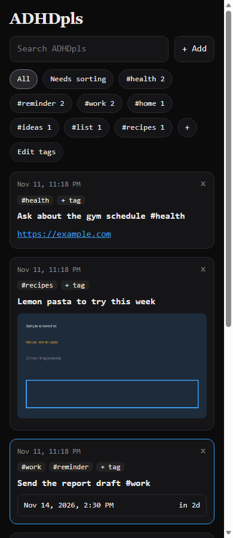
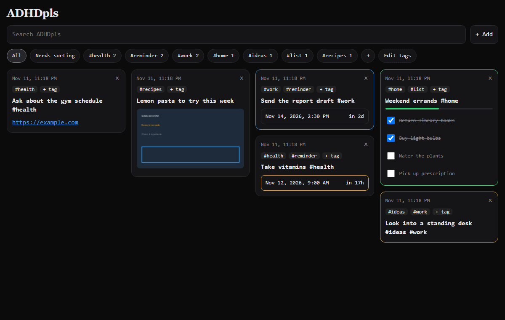

# ADHDpls

A free, self-hosted dashboard for brains that lose things. Jot a note, make a checklist, set a reminder, tag it, and find it again. Phone screenshots can flow in automatically from your own [Immich](https://immich.app/) photo server so they stop dying in the camera roll.

<p>
  
  
</p>

*(Screenshots use made-up sample cards.)*

## Why it exists

Paid ADHD capture-and-reminder apps are nice, but a subscription for a notes page felt wrong, and I already run a home server. ADHDpls is the smallest version of that idea that I would actually use every day: one page, everything searchable, nothing leaves my network.

## What it does

| Feature | How it works |
|---|---|
| Cards | Notes, checklists with a progress bar, reminder cards with a countdown, and image cards |
| Hashtags are the categories | Type `#home` anywhere in a card, or tap a tag. `#list` and `#reminder` are built in: they decide how a card is drawn. |
| Tag bar | Filter by tag, add your own with **+**, remove one with **Edit tags** (the cards are kept) |
| Search | Matches card text, checklist items and tags |
| "Needs sorting" | Shows image cards that have no tag yet (or only the automatic `#screenshot` tag), so a pile of screenshots has a clear next step |
| Images | Add from the camera or gallery, drag and drop, or paste. Each image becomes its own card. Real image type is checked from the file contents, not the name. |
| Immich screenshots (optional) | Pulls screenshots from your Immich server in as image cards, every 5 minutes or on demand. A screenshot you delete here is never imported again. |
| Google Calendar (optional) | Puts `#reminder` cards on a calendar so your phone pings you. See the honest note below. |

## Quick start

You need Docker with Compose.

```bash
git clone https://github.com/vernalynt/adhdpls.git
cd adhdpls
cp .env.example .env
docker compose up -d --build
```

Open <http://localhost:5055>.

### Using it from your phone

By default it only listens on the computer it runs on. To reach it from phones, set `BIND_IP` in `.env` to a **private** address of that machine, for example the one from `tailscale ip -4` if you use [Tailscale](https://tailscale.com/), then run `docker compose up -d` again and open `http://THAT-ADDRESS:5055` on the phone.

## Optional: Immich screenshots

1. In Immich, create an API key (Account Settings, API Keys) with the permissions `asset.read` and `asset.view`.
2. Put these in `.env`:
   ```
   IMMICH_URL=http://host.docker.internal:2283
   IMMICH_API_KEY=paste-your-key-here
   ```
   (`host.docker.internal` works when Immich runs on the same machine. Otherwise use Immich's address.)
3. `docker compose up -d`. A **Sync screenshots** button appears, and a background sync runs every 5 minutes.

It imports every Immich image whose file name starts with `Screenshot` (change `IMMICH_NAME_PREFIX` if your phone names them differently). The browser never sees your API key: images are fetched through the app.

It was written against the Immich v3.2.x API and used against a live Immich v3.2.4 server. Other versions may differ.

## Optional: Google Calendar

Reminder cards can create calendar events through a Google service account.

1. Create a service account in Google Cloud, enable the Calendar API, and create a JSON key. Save it as `secrets/gcal.json`.
2. Share your calendar with the service account's email address, with "Make changes to events".
3. In `.env`, set `GCAL_CALENDAR_ID` (from the calendar's settings) and `GCAL_TIMEZONE`.

**Honest note:** this code is tested against a fake Google session (create, update, recreate after a deletion, delete, and an outage that is retried later), but the author never ran it against the real Google API. Google may refuse to let you create a key: an organization policy ([`iam.disableServiceAccountKeyCreation`](https://docs.cloud.google.com/resource-manager/docs/organization-policy/restricting-service-accounts)) blocked it for the author, and the feature was parked. If you get it working, please open an issue.

## Settings

All settings live in `.env` (see `.env.example`).

| Setting | Default | What it does |
|---|---|---|
| `BIND_IP` | `127.0.0.1` | Which address the port is published on |
| `PORT` | `5055` | The port |
| `IMMICH_URL`, `IMMICH_API_KEY`, `IMMICH_NAME_PREFIX` | blank, blank, `Screenshot` | Immich screenshot sync. Blank means off. |
| `GCAL_CALENDAR_ID`, `GCAL_CREDENTIALS_FILE`, `GCAL_TIMEZONE` | blank, `/secrets/gcal.json`, `UTC` | Google Calendar sync. Blank calendar ID means off. |

## Security: read this

**There is no login.** Anyone who can reach the page can read and change your cards. Keep it on a private network.

| Protection | What it does |
|---|---|
| Private bind address | The port is published on one address you choose, `127.0.0.1` by default |
| Same-site guard | A write that comes from another website's page is refused with `403` |
| Image checks | Uploads are checked by their first bytes (PNG, JPEG, GIF, WebP only), saved under random names, and served with `nosniff`. Cards cannot point at outside image URLs. |
| Keys stay server-side | The Immich key and Google key are never sent to the browser |
| Upload limit | 25 MB per request |

**Do not publish the port to the open internet.** Also note that [Docker's own documentation](https://docs.docker.com/engine/network/packet-filtering-firewalls/) says published container ports can bypass a host firewall like `ufw`, which is why this project binds to a specific address instead of relying on the firewall.

## Your data and backups

Your data is `data/adhdpls.db` (SQLite) and the `data/uploads/` folder. Back up the database with SQLite's own backup rather than a plain file copy, which can be damaged if the app is writing at that moment:

```bash
python3 - <<'PY'
import sqlite3
src = sqlite3.connect("data/adhdpls.db")
dst = sqlite3.connect("adhdpls-backup.db")
src.backup(dst)
PY
```

Then copy `data/uploads/` as normal files. The `mewseum` repository in the same project family has a script that does both.

## Run it without Docker (development)

```bash
python -m venv .venv
. .venv/bin/activate            # Windows: .venv\Scripts\activate
pip install -r requirements.txt
python app.py                   # http://127.0.0.1:5055
```

Run the tests (22 of them, with fakes for Immich and Google, no network needed):

```bash
python -m unittest discover -s tests -v
```

## How it is built

Flask, SQLite, plain JavaScript, gunicorn in the container. No front-end build step. It runs **one** gunicorn worker on purpose, because the background sync thread lives inside it.

| File | Job |
|---|---|
| `app.py` | The web app and API |
| `immich.py` | Talks to Immich (search, thumbnails) |
| `gcal.py` | Talks to Google Calendar |
| `static/index.html` | The whole interface |

## Honest limits

- Reminder cards show a countdown on the page. There are **no push notifications yet**. The optional Calendar sync is the way to get a ping, and it is unverified against the real API (see above).
- You add cards through the web page. Texting or chatting a card in is not built.
- There are no user accounts.

## License

MIT, see `LICENSE`.
